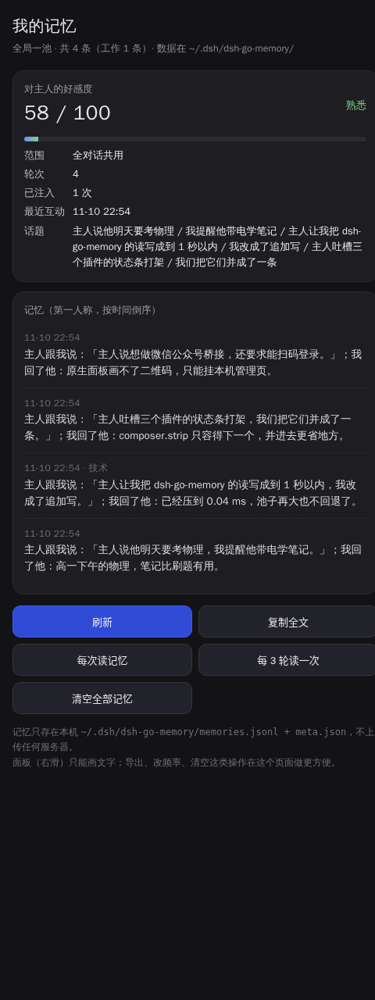
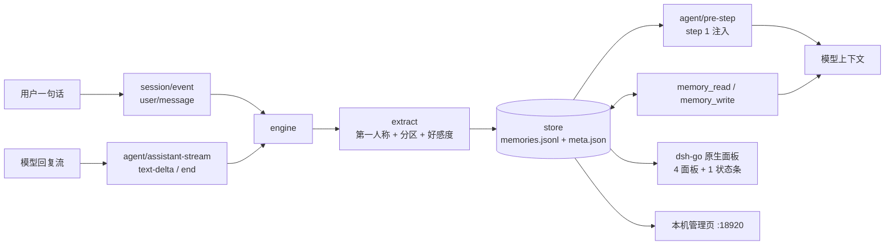

# dsh-go-memory

> **本插件仅独家适配 [DSH-go](https://github.com/ccch1mneyyy/dsh-Go) 这一项目**
>
> 它是把 dsh 插件跑在 dsh-go 上的定制实现：界面全部走 dsh-go 的原生面板 / 状态条协议，
> 不塞网页、不改 dsh-go 的 Kotlin / Flutter 原生层代码。脱离 dsh-go 使用不在支持范围内。

[项目地址](https://github.com/ccch1mneyyy/dsh-Go) ·
[当前插件版本 `0.1.0-dshgo.7`](https://github.com/Daijincy/dsh-go-memory/releases) ·
[问题反馈](https://github.com/Daijincy/dsh-go-memory/issues)




---

## 目录

- [它做什么](#它做什么)
- [三条设计取舍](#三条设计取舍)
- [两条铁律](#两条铁律写死无开关)
- [在 dsh-go 里长什么样](#在-dsh-go-里长什么样)
- [安装](#安装)
- [工具](#两个工具)
- [性能](#性能)
- [架构](#架构)
- [数据文件](#数据文件)
- [管理页接口](#管理页接口)
- [开发与自测](#开发与自测)
- [常见问题](#常见问题)
- [许可](#许可)

## 它做什么

每聊一轮，插件自动把「这一轮发生了什么」提炼成一条**第一人称**记忆，顺手结算一次**好感度**；这些记忆会在后续回复前被塞回模型上下文，让对话有连续性。

- **单一记忆池**：不按会话分片。所有对话共用一池记忆与一个好感度，新对话开局就能想起以前的事。
- **带时间戳、按第一人称写**：`我记得主人说过…`，不是冷冰冰的键值对。
- **自动分区**：出现代码、端口、部署、报错、接口、模型这类内容，归到「工作技术」；其余归「日常」。
- **好感度**：起步 50，每轮 +2 起，暖话加成、冷话扣分，单日涨幅有上限，扣分不封顶。
- **全本机**：数据只写 `~/.dsh/dsh-go-memory/`，不联外网、不调外部模型、不上传。

## 三条设计取舍

| 取舍 | 为什么 |
|---|---|
| **只做 dsh-go，不做通用 dsh** | 面板、状态条、图标白名单全是 dsh-go 的私有协议，硬套到别处只会两套 UI 都不像样 |
| **不往 WebView 里塞网页** | dsh-go 的原生层不归插件改；塞网页会白屏，且和原生手势打架 |
| **长文本只在本机管理页看** | 原生面板只能画文字与列表（≤32 KiB / 120 节点），导出、清理放管理页更合适 |

## 两条铁律（写死，无开关）

1. **每次对话开始先读记忆** —— 任何会话的第一步都把池子里的记忆注入上下文，哪怕这个会话自己一条都没有；
2. **每次对话结束必写记忆** —— 一轮结束立刻写进同一池，写的是第一人称 + 时间戳 + 分区。

这两件事同时以**工具**形式暴露给模型（`memory_read` / `memory_write`），模型可以主动读写；但**即使模型一次都没调**，插件自己也照铁律读过、写过了。

## 在 dsh-go 里长什么样

右滑栏 / 面板列表里多出 4 个原生面板，加 1 条输入框上方的状态条。

| 面板 | 内容 | 动作 |
|---|---|---|
| **记忆** | 全池记忆，新的在上，副标题标「技术 / 对话 / 进程 / 手写」，每条带时间戳 | 刷新 / 复制全部 |
| **工作记忆** | 只放技术类（代码、端口、部署、报错、接口、模型…），独立分区 | 刷新 / 复制工作记忆 |
| **好感度** | 分数、等级、轮次、注入次数、最近互动时间 | 刷新 / 复制记忆 |
| **聊天进程** | 轮次统计、最近话题、注入频率 | 每次读记忆 / 每 3 轮读一次 |

状态条一行：

```
记忆 12 · ♥64
记忆 12 · ♥64 · 微信·2在线      ← 微信桥在场时并进来
```

> `composer.strip` 的容量是 **1**，多个插件会抢插槽。所以本插件占了这唯一一条，把微信在线数并进同一行（≤24 字）。

## 安装

从 Release 装：

```bash
dsh plugin --profile go add https://github.com/Daijincy/dsh-go-memory/releases/download/v0.1.0-dshgo.7/dsh-go-memory-0.1.0-dshgo.7.tgz
```

本地 `npm pack` 出来的包一样装：

```bash
dsh plugin --profile go add dsh-go-memory-0.1.0-dshgo.7.tgz
```

启动后日志会打一行：

```
[记忆] 管理页 http://127.0.0.1:18920  （导出/清理/改注入频率）
```

端口可用环境变量 `DGM_MOBILE_PORT` 改，设 `0` 即关闭；被占用时自动回落到随机端口。它只监听 `127.0.0.1`。

## 两个工具

| 工具 | 参数 | 返回 |
|---|---|---|
| `memory_read` | `limit?`（默认 8，最多 50） | `detail`：时间 + 第一人称正文的清单；另带 `total` / `score` / `level` |
| `memory_write` | `text`（必填）、`bucket?`（`work` / `chat`） | `detail`：`已记下：…` |

注册走宿主标准契约：

```js
ctx.get('tools').register({ name, description, parameters, output: { schema, render }, execute })
```

没有 `tools` 服务的宿主上注册是空操作，不影响其余功能。

## 性能

早先的写法是「整池序列化 + `writeFileSync` + rename」，池子越大越慢。现在拆成小步：

| 动作 | 做的事 | 实测（同机 200 次连测） |
|---|---|---|
| 读（工具 / 注入） | 纯内存切片，不碰磁盘 | 均值 **0.04 ms**，最差 2.2 ms |
| 写（工具 / 一轮结束） | 数组 push + `appendFileSync` 追加一行（几百字节） | 均值 **0.04 ms**，最差 0.17 ms |
| 好感度 / 计数 | 合并写 `meta.json`，400 ms 一次，几百字节 | 忽略不计 |
| 超 500 条压缩 | `writeFile` + `rename` **异步**重写，不阻塞回复 | 每 100+ 次写才触发一次 |
| 新会话开局注入 | 首次含读盘，之后纯内存 | **8–16 ms** |

自检里带断言：单次读写最差必须 < 1 秒，均值必须 < 20 / 5 ms，慢了直接失败。

## 架构



```
index.js                 插件入口：事件接线、注入、工具挂载、面板挂载
├── src/memory
│   ├── engine.js        回合缓冲、写记忆、注入判断、统计
│   ├── store.js         追加写 jsonl + meta 合并写 + 异步压缩 + 旧数据迁移
│   ├── extract.js       提炼第一人称记忆、分区、好感度加减分
│   ├── prompt.js        注入文本拼装、话题摘要、工具铁律
│   └── tools.js         memory_read / memory_write
├── src/dshgo
│   ├── bridge.js        挂载入口
│   ├── state.js         面板快照（同步、只读内存）
│   ├── views.js         4 个视图 + 状态条文案
│   ├── panels.js        面板 / strip 注册与刷新循环
│   └── mobile.js        18920 管理页与 7 个接口
├── mobile/index.html    单文件管理页
└── test/                stub 端到端 + 跨对话验证
```

## 数据文件

```
~/.dsh/dsh-go-memory/
├── memories.jsonl   # 一条记忆一行
└── meta.json        # 好感度与计数，400 ms 合并写
```

旧版单文件 `memories.json` 首次加载自动迁移成 `.jsonl`，原件改名 `.bak`，历史一条不丢。

## 管理页接口

| 接口 | 说明 |
|---|---|
| `GET /` | 单文件管理页（记忆列表、好感度、导出、清空） |
| `GET /api/status` | 精简状态：条数、工作条数、分数、等级、轮次、写入、注入、设置 |
| `GET /api/perf` | 读 / 写 / 注入的累计与均值、落盘计时 |
| `GET /api/memory` | 完整快照 + 可导出文本 |
| `GET /api/export` | 下载 Markdown |
| `POST /api/config` | `{"injectEvery": 1}` 改注入频率 |
| `POST /api/reset` | 清空整池 |

## 开发与自测

```bash
node test/stub.mjs      # 端到端：写入 / 工具 / 注入 / 四面板 / 管理页 / 性能断点
node test/recall.mjs    # 跨对话：A 说一句 → 新开 B 会话能否立刻带出来
node scripts/screenshot.mjs docs   # 重新生成 README 里的管理页截图
```

官方校验器（dsh-go 仓库自带）：

```bash
node kit/bin/check.mjs <包目录> --load
# 原生界面能显示（状态条 1 · 面板 4）
# 已加载宿主半侧：5 项可用；注册了工具：memory_read、memory_write
```

包本身零依赖，只有 Node 内置模块；Node ≥ 20。

## 常见问题

**Q：为什么新对话能记得以前的事？**
A：记忆不按会话分片，只有一池。任何会话的第一步都注入这池内容（实测 8–16 ms）。

**Q：关了插件，记忆会丢吗？**
A：不会。都落在 `memories.jsonl`，重装/升级不会清空；只有你点「清空全部记忆」才清。

**Q：会占多少上下文？**
A：默认每次取 6 条、每条截 180 字，注入段一般 300–500 字符。

**Q：能和别的插件共存吗？**
A：面板各占各的，互不影响；只有输入框上方状态条是容量 1，本插件已把微信在线数并进同一行。

**Q：为什么没有会话级记忆？**
A：早期版本做过，结果是新对话开局读不到历史。改成单池后才有「跨对话记得你」的效果。

## 许可

[MIT](LICENSE) © 2026 Daijincy
